<div align="center">


# Sistema Bibliotecario
### Academia Boyacense de Historia

Aplicación web para administrar el inventario bibliográfico de la Academia y registrar las consultas que los visitantes hacen sobre sus libros.


[Funcionalidades](#-funcionalidades) ·
[Capturas](#-recorrido-por-la-aplicación) ·
[Stack](#-stack-tecnológico) ·
[Arquitectura](#-arquitectura) ·
[Ejecución local](#-ejecución-local)

</div>

---

## 📖 Sobre el proyecto

Proyecto académico desarrollado en 2020 como trabajo final de la asignatura **Gerencia Informática** del programa de Ingeniería de Sistemas y Computación de la **Universidad Pedagógica y Tecnológica de Colombia (UPTC), seccional Sogamoso**, para la **Academia Boyacense de Historia** (Tunja, Boyacá).

El sistema reemplaza el control manual del inventario: organiza los libros por categorías y colecciones, registra qué visitante consultó cada ejemplar y sobre qué tema, y genera reportes en PDF.

> [!NOTE]
> Este repositorio conserva la **versión original** del proyecto (Laravel 5.5 + Vue 2), recuperada y puesta en marcha con Docker. Está prevista su actualización a versiones vigentes del stack.

<div align="center">
  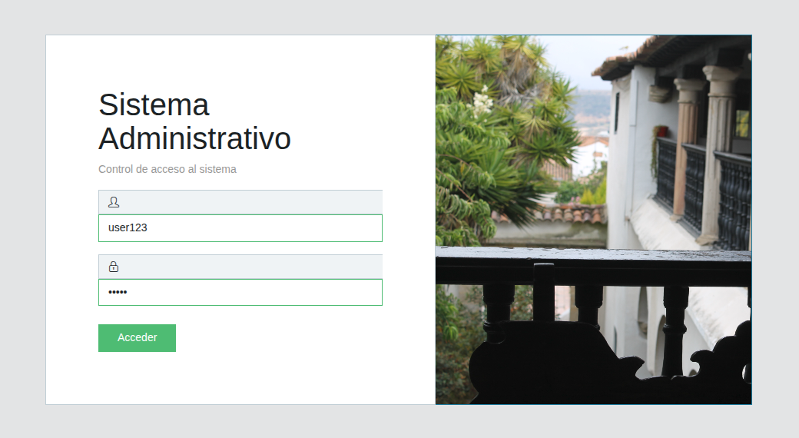
  <br>
  <sub><b>Inicio de sesión</b> — acceso con usuario y contraseña; el menú disponible depende del rol.</sub>
</div>

---

## ✨ Funcionalidades

| | Módulo | Qué permite hacer |
|:-:|---|---|
| 📊 | **Escritorio** | Ver una gráfica de los ejemplares registrados por mes durante el año en curso. |
| 🏷️ | **Categorías** | Clasificar el inventario por área temática: crear, editar, activar y desactivar. |
| 🗂️ | **Colecciones** | Agrupar los libros por su origen o serie (fondo general, donaciones, publicaciones propias…). |
| 📚 | **Ejemplares** | Inventario completo con portada, autor, editorial, año, cantidad e indicador de obra propia. Búsqueda, paginación y **reporte PDF**. |
| 📝 | **Registros** | Registrar quién consultó qué libro y sobre qué tema. Búsqueda y **reporte PDF**. |
| 👥 | **Usuarios** | Administrar las cuentas de acceso con sus datos de contacto y rol. |
| 🔐 | **Roles** | Consultar los perfiles disponibles: Administrador y Secretario. |
| ❓ | **Ayuda** | Descargar los manuales de usuario y de programador. |
| ℹ️ | **Acerca de** | Conocer el origen del proyecto y las tecnologías empleadas. |

### Roles

| Rol | Acceso |
|---|---|
| 🛡️ **Administrador** | Todos los módulos, incluida la gestión de usuarios y roles. |
| 🗃️ **Secretario** | Escritorio, Categorías, Colecciones, Ejemplares, Registros, Ayuda y Acerca de. |

Los registros nunca se eliminan: cada módulo usa **activación y desactivación** (borrado lógico) para conservar el historial.

---

## 🖼️ Recorrido por la aplicación

> Las capturas son de la aplicación en ejecución local con datos de ejemplo. Los nombres, celulares y correos de personas aparecen pixelados.

### 🏷️ Categorías

Listado con búsqueda por criterio y estado de cada categoría. Desde aquí se crean, editan y desactivan.

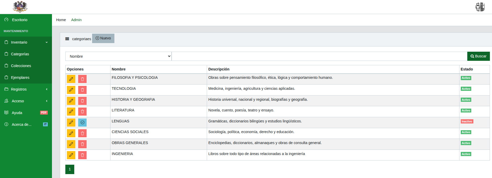

<table>
  <tr>
    <td width="50%" align="center">
      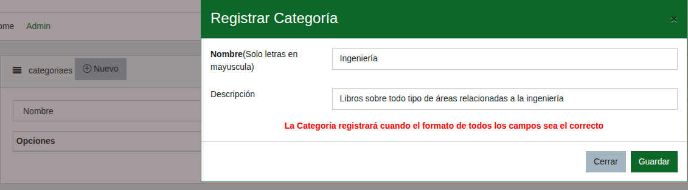<br>
      <sub><b>Nueva categoría</b> — el nombre se escribe en mayúsculas sin tildes; la validación lo verifica antes de guardar.</sub>
    </td>
    <td width="50%" align="center">
      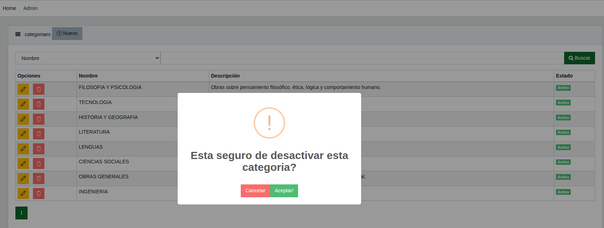<br>
      <sub><b>Desactivar</b> — se pide confirmación antes de cambiar el estado.</sub>
    </td>
  </tr>
</table>

<div align="center">
  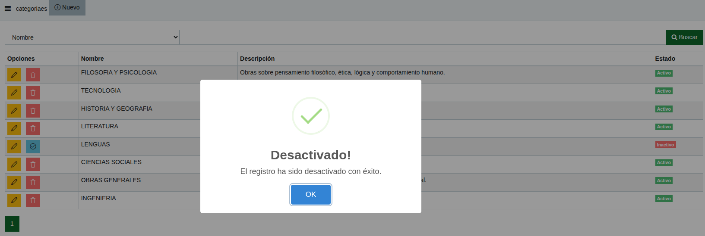<br>
  <sub><b>Resultado</b> — la categoría pasa a <i>Inactivo</i> y su botón cambia a <i>Activar</i>, sin perder la información.</sub>
</div>

### 🗂️ Colecciones

Mismo flujo que las categorías, orientado a agrupar los libros por procedencia o serie.

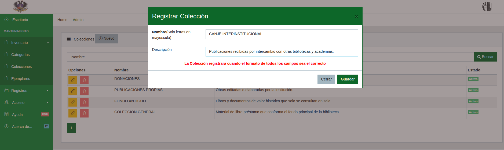

### 📚 Ejemplares

El inventario muestra categoría, colección, datos editoriales, cantidad disponible y la portada de cada libro. El botón **Reporte** descarga el listado completo en PDF.

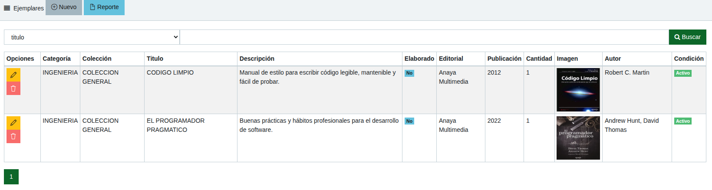

<div align="center">
  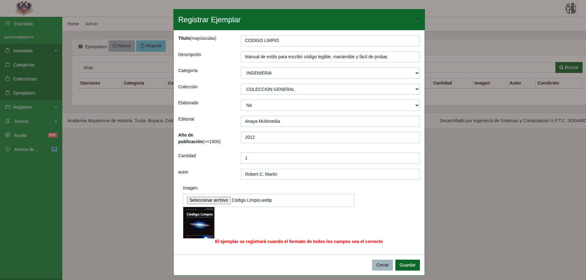<br>
  <sub><b>Nuevo ejemplar</b> — se eligen categoría y colección, se indica si la obra fue elaborada por la Academia y se carga la portada con vista previa.</sub>
</div>

### 📝 Registros de consulta

Cada visita queda registrada con el tema investigado, el libro consultado y los datos de contacto del visitante.

<table>
  <tr>
    <td width="40%" align="center">
      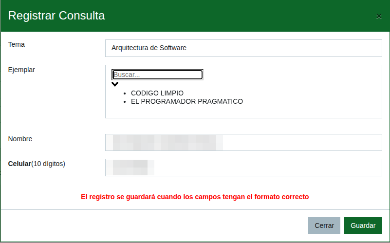<br>
      <sub><b>Nueva consulta</b> — el ejemplar se busca por título en un selector con filtro.</sub>
    </td>
    <td width="60%" align="center">
      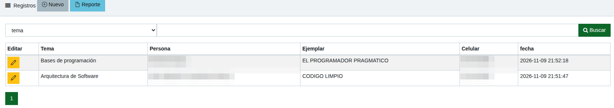<br>
      <sub><b>Historial de consultas</b> — búsqueda por tema y exportación a PDF.</sub>
    </td>
  </tr>
</table>

### 👥 Usuarios y roles

<table>
  <tr>
    <td width="40%" align="center">
      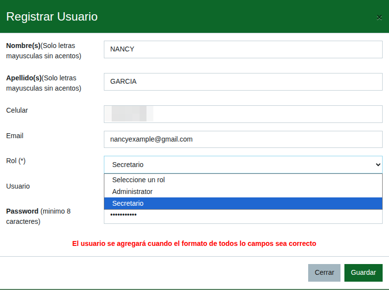<br>
      <sub><b>Nuevo usuario</b> — datos personales, rol, nombre de usuario y contraseña de al menos 8 caracteres.</sub>
    </td>
    <td width="60%" align="center">
      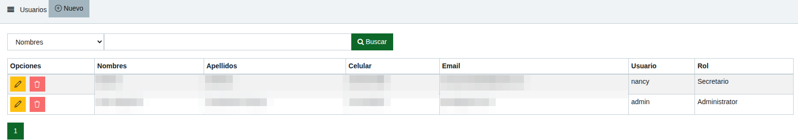<br>
      <sub><b>Usuarios</b> — cuentas con su rol asignado.</sub>
      <br><br>
      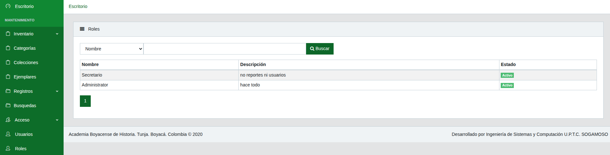<br>
      <sub><b>Roles</b> — perfiles disponibles en el sistema.</sub>
    </td>
  </tr>
</table>

### ❓ Ayuda y Acerca de

<table>
  <tr>
    <td width="50%" align="center">
      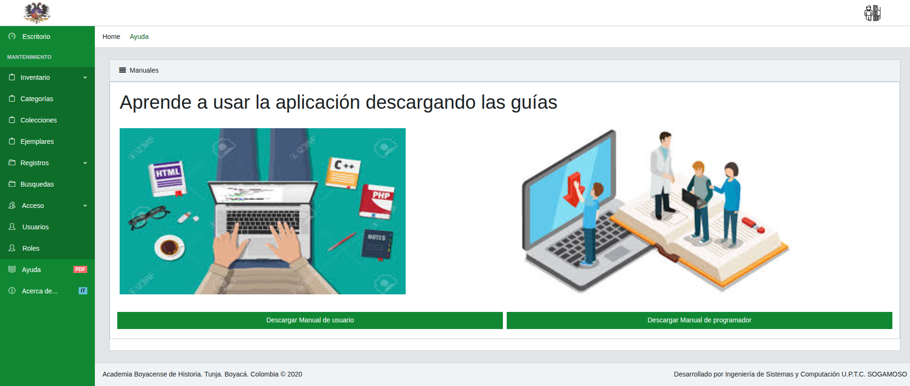<br>
      <sub><b>Ayuda</b> — descarga de los manuales de usuario y de programador en PDF.</sub>
    </td>
    <td width="50%" align="center">
      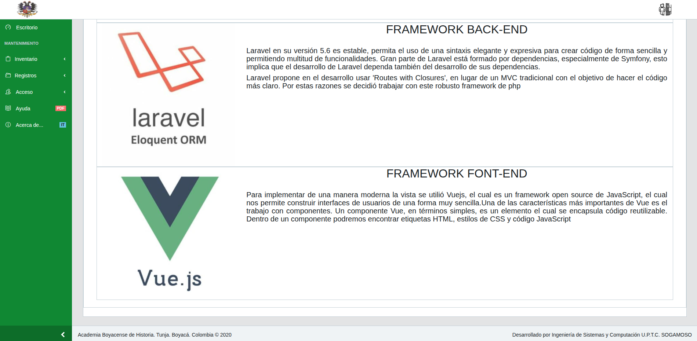<br>
      <sub><b>Acerca de</b> — origen del proyecto y frameworks utilizados.</sub>
    </td>
  </tr>
</table>

<div align="center">
  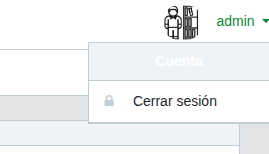<br>
  <sub><b>Cerrar sesión</b> — desde el menú de cuenta en la esquina superior derecha.</sub>
</div>

---

## 🧰 Stack tecnológico

| Capa | Tecnología |
|---|---|
| **Backend** | PHP 7.2 · Laravel 5.5 · Eloquent ORM |
| **Base de datos** | MySQL 5.7 |
| **Frontend** | Vue.js 2 (componentes de un solo archivo) · Axios · vue-select |
| **Interfaz** | Plantilla CoreUI 1.0 · Bootstrap 4 · Font Awesome · Simple Line Icons |
| **Gráficas y alertas** | Chart.js · SweetAlert2 |
| **Reportes** | barryvdh/laravel-dompdf 0.8 (Dompdf) |
| **Compilación de assets** | Laravel Mix 2 (webpack) |
| **Dependencias** | Composer 1 · npm |
| **Entorno local** | Docker Compose · Apache + PHP 7.2 · MySQL 5.7 |

---

## 🏗️ Arquitectura

La aplicación sigue el patrón **MVC de Laravel** con una interfaz de **página única (SPA)**. Después del inicio de sesión, Laravel entrega una sola vista Blade y cada módulo es un componente Vue que consulta el backend por AJAX y recibe JSON.

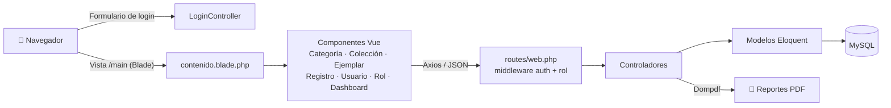

### Modelo de datos

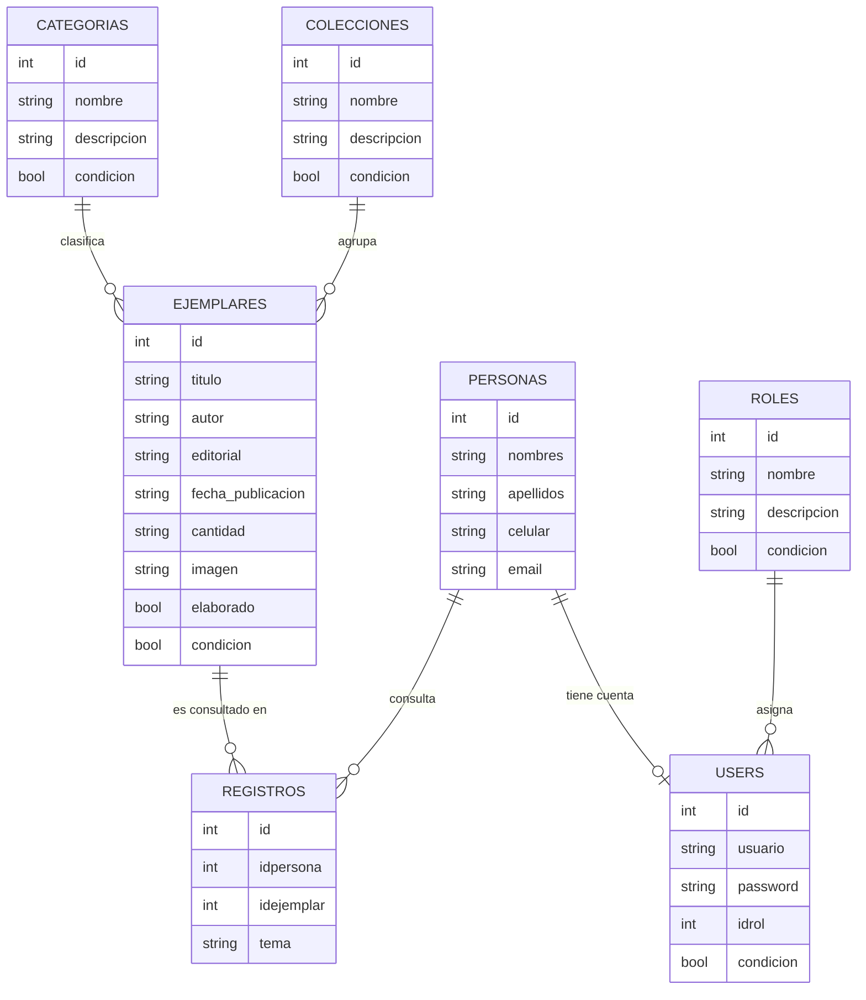

- `users.id` es a la vez clave primaria y clave foránea hacia `personas.id`: cada usuario es una persona.
- El campo `condicion` implementa el borrado lógico (activar y desactivar).

### Estructura del proyecto

```
app/
├── Http/Controllers/        # Un controlador por módulo + Auth/LoginController
├── Http/Middleware/         # Administrador, Secretario
└── *.php                    # Modelos Eloquent
database/
├── migrations/              # Esquema de la base de datos
└── seeds/                   # Roles y usuario administrador inicial
resources/
├── assets/js/components/    # Componentes Vue de cada módulo
├── assets/plantilla/        # CSS y JS de la plantilla CoreUI
└── views/                   # Login, layout principal, menús por rol y plantillas PDF
routes/web.php               # Rutas agrupadas por rol
public/                      # Punto de entrada, assets compilados, imágenes y manuales
docker/, docker-compose.yml  # Entorno local
docs/capturas/               # Capturas usadas en este README
```

---

## 🚀 Ejecución local

**Requisito:** Docker con Docker Compose. Los assets ya están compilados en `public/`, así que no se necesita Node para ejecutar la aplicación.

**1. Configurar el entorno**

```bash
cp .env.example .env
```

En `.env`, definir `DB_HOST=biblioteca_db`, `DB_DATABASE`, `DB_USERNAME`, `DB_PASSWORD` y `APP_URL=http://localhost:8090`.

**2. Levantar los contenedores**

```bash
docker compose up -d --build
```

**3. Instalar dependencias y crear la base de datos con el usuario administrador**

```bash
docker exec -u www-data biblioteca_app composer install
docker exec -u www-data biblioteca_app php artisan key:generate
docker exec -u www-data biblioteca_app php artisan migrate --seed
```

**4. Abrir** <http://localhost:8090> e iniciar sesión con el usuario definido en `database/seeds/UserSeeder.php`.

| Servicio | Contenedor | Puerto local |
|---|---|---|
| Aplicación (Apache + PHP) | `biblioteca_app` | `127.0.0.1:8090` |
| Base de datos (MySQL) | `biblioteca_db` | `127.0.0.1:3317` |

Para detener el entorno se usa `docker compose down`; agregar `-v` borra también el volumen de la base de datos.

---

## 📄 Documentación

En `public/` se incluyen el **Manual de Usuario** y el **Manual de Programador** en PDF, elaborados con la versión original. También se descargan desde el módulo **Ayuda**.

## ⚖️ Licencia

Proyecto académico distribuido bajo licencia MIT.

<div align="center">
<sub>Academia Boyacense de Historia · Tunja, Boyacá, Colombia · UPTC Sogamoso · 2020</sub>
</div>
